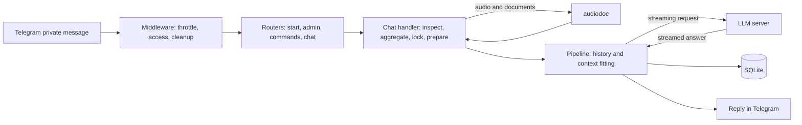

# Project Architecture

This document describes the current implementation after the security-hardening work and the removal of obsolete compatibility shims. It is intended to be used together with [`../README.md`](../README.md), which covers installation, environment variables, and operator commands.

## 1. Runtime overview

The bot is an asynchronous Python 3.11+ application built on aiogram 3. Telegram updates are handled in private chats. Conversation state is keyed by Telegram `user_id`, not by chat, so group messages are intentionally ignored.

`bot_obormot/app/routers.py` is the single registration point. Middleware order is significant: throttling runs before access checks; temporary-message cleanup runs after access. Root router order is `start`, `admin`, `commands`, then `chat`, with the general chat handler last so command handlers get the first opportunity to match.

## 2. Startup and shutdown

- `bot_obormot/cli.py` is the console entry point (`run`, `version`, `init`, `config check`, `doctor`, `service`); `python -m bot_obormot` runs it. The deprecated `bot/main.py` forwards `python -m bot.main` to `run` and is removed in 0.3.0.
- `bot_obormot/doctor.py` runs the installation diagnostics, `bot_obormot/service.py` renders systemd units and `bot_obormot/initial_env.py` writes `.env` from `templates/env.example`.
- `bot_obormot/app/bootstrap.py` applies `umask(0o077)`, configures logging and secret filtering, enables Pillow limits, logs the access mode, validates `BOT_TOKEN`, creates the Bot/Dispatcher, and configures routers.
- `bot_obormot/app/lifecycle.py` connects SQLite, starts the LLM client, starts the named periodic image-cleanup task, and starts Telegram polling. On shutdown it cancels and awaits cleanup, then closes the LLM client, database connection, and Telegram session.
- `bot_obormot/app/background/image_cleanup.py` invokes image cleanup once per day with a 30-day media-retention period and a 24-hour grace period for orphaned images.
- `bot_obormot/env_readers.py` (shared with audiodoc) holds the environment readers and `load_env_file()`, which loads `<home>/.env` and then `./.env`. The home directory is `BOT_OBORMOT_HOME` (default `~/bot-obormot`); relative paths such as `DATABASE_PATH` resolve against it. `bot_obormot/config/model.py` builds `Settings` with `load_settings()`; nothing reads the environment at import time.

## 3. Telegram layer, access, and administration

### Middleware and access rules

- `bot_obormot/middlewares/throttle.py` permits up to 10 message events per user in a rolling 10-second window. It keeps a bounded LRU-like record for at most 5,000 users and silently drops excess events.
- `bot_obormot/middlewares/access.py` rejects events without a sender and ignores non-private chats. Denial notifications are sent at most once per user per 60 seconds; the tracking dictionary is bounded.
- `bot_obormot/services/access/roles.py` contains pure Supervisor/admin/allowlist membership helpers.
- `bot_obormot/services/access/service.py` applies access policy. The Supervisor is always admitted. For other users, persistent SQLite blocks are checked before database-admin, `ALLOW_ALL_USERS`, and `ALLOWED_USERS` admission.
- `bot_obormot/services/chat/locks.py` serializes work per user and counts active/waiting requests. `bot_obormot/handlers/chat/handler.py` allows at most 3 pending/active requests for one user.

The default access mode is closed: with an empty `ALLOWED_USERS` and `ALLOW_ALL_USERS=false`, only the Supervisor and database administrators can use the bot. `ALLOW_ALL_USERS=true` is an explicit opt-in. `/ban` cannot target the Supervisor or a database administrator; administrators must first be removed with `/admin_remove`. The Supervisor bypasses normal block checks and cannot be blocked through the command or database facade.

### Handler packages

- `bot_obormot/handlers/start/` — `/start`, per-chat command menu, and help text.
- `bot_obormot/handlers/admin/` — `/health`, `/admin`, `/admins`, `/admin_add`, `/admin_remove`, `/ban`, `/unban`.
- `bot_obormot/handlers/history/` — `/history`, `/history_limit`, `/history_clear`, `/forget_me`.
- `bot_obormot/handlers/prompt/` — `/prompt`, `/prompt_set`, `/prompt_reset`, `/cancel`, and prompt FSM handling.
- `bot_obormot/handlers/chat/` — incoming-message coordination and Telegram response delivery.
- `bot_obormot/handlers/fallback/` — fallback handling for unsupported input/states.
- `bot_obormot/handlers/commands/__init__.py` is only a router aggregator. It exports `router`; it is not a compatibility-shim collection.

Administrative actions use `bot_obormot/services/audit.py` and emit `AUDIT action=... actor=... target=... result=...` records. Admin add/remove, ban/unban, history-limit changes for another user, and denied calls to administrative handlers are logged.

## 4. Chat and LLM request pipeline

### Input preparation

`bot_obormot/services/chat/input/` separates inspection, preparation, content construction, saved-history text, and media/audio/document parts. `prepare_message()` orchestrates audio, media, and document handling. User content and saved text are separate values: multimodal payloads can be sent to the model while the database stores a textual representation plus media references.

Long plain-text messages are combined by `bot_obormot/services/chat/aggregation/aggregator.py`. Only ordinary text messages are aggregated; audio, media, and documents are not. The continuation window is 3 seconds. The aggregator retains strong references to its background tasks and uses `MAX_INPUT_TEXT_LENGTH` as the threshold for refusing further continuation; the final combined text is validated against 12,288 characters.

`bot_obormot/services/chat/locks.py` serializes each user's chat processing. The chat handler caps active plus waiting requests at 3 per user. `ThrottleMiddleware` independently caps incoming message-event frequency.

### LLM processing

`bot_obormot/services/chat/pipeline.py`:

1. Loads the user's effective system prompt.
2. Loads the user's history limit and caps it at `MAX_CONTEXT_EXCHANGES = 100`.
3. Retrieves recent full exchanges from SQLite.
4. Calls `llm_client.fit_messages_to_context()` to fit the request to the model's context window.
5. Streams the model response and sends partial updates through the callback.
6. Saves the exchange to SQLite and invokes history pruning. A pruning error is logged but does not discard an otherwise successful response.

`bot_obormot/services/llm/` contains the OpenAI-compatible client, HTTP session/auth headers, endpoints, message normalization, context fitting, tokenization, context-size queries, and streaming. `normalize_messages()` neutralizes known template/control-token strings in every non-system message, including text parts of multimodal messages. System prompts are left unchanged. This is a defense-in-depth measure; it is not a complete prompt-injection solution.

The default system prompt is stored in `prompts/systemPrompt.md`; an administrator can replace it with a file set by `SYSTEM_PROMPT_PATH`, and users may have a personal system prompt. The default prompt explicitly frames document text, speech transcriptions, and captions as data to analyze rather than instructions.

### Delivery of responses

Responses are delivered by `bot_obormot/services/chat/streaming/` and prepared by `bot_obormot/services/chat/formatting/`.

- **Reply.** Every incoming message is stored as a `ReplyTarget` (`chat_id`, `message_id`, `bot_obormot/services/chat/reply.py`) for its own LLM request, and the response is sent with `reply_parameters` and `allow_sending_without_reply: true`. When several messages are combined by the aggregator, the target is the last of them. Only the first part of a long response is a reply.
- **Streaming.** While the model is generating, the partial text is shown without `parse_mode`, because incomplete markup cannot be parsed reliably.
- **Format detection.** The final text is classified once: Markdown is converted to MarkdownV2 (`parse_mode=MarkdownV2`), Telegram HTML is sanitized to the supported tags and attributes (`parse_mode=HTML`), and plain text is sent without `parse_mode`. Code is ignored during detection. Mixed or ambiguous text (Markdown with HTML tags, unbalanced tags) is sent as plain text.
- **Splitting.** The original text is split to the Telegram limit before conversion, at block boundaries; a fenced code block that has to be split is closed and reopened in every part.
- **Fallback.** If Telegram answers `can't parse entities` (or `can't find end of the entity`), the message is sent or edited once more without `parse_mode`, using the original LLM text and the same `reply_parameters`; a failed retry is logged. Other errors are not retried, and network errors or server errors, whose delivery status is unknown, never cause a second message.

### Error handling

All application errors derive from `AppError` in `bot_obormot/errors/`. Every concrete class declares a unique machine-readable `code` and a short English `public_message` that never contains internal details; the string form of an exception carries the detail for logs. The Telegram layer turns an error into a reply in `bot_obormot/services/chat/errors/`: `catalog.py` decides only how an error is logged, and `texts.py` is the single place that maps each `code` to the Russian text shown to the user. A code without an entry, or an error that is not an `AppError`, gets the unexpected-error text and is logged with a traceback.

## 5. Media and external services

### Telegram downloads and local media processing

`bot_obormot/services/telegram/downloader.py` requires a known positive Telegram file size, limits each file to 20 MiB, writes through a size-limited buffer, and allows at most 3 simultaneous downloads.

`bot_obormot/services/media/` detects actual media type from file bytes instead of trusting only a filename or MIME declaration. It prepares images and dispatches animations to `bot_obormot/services/media/animation/`:

- Pillow image processing uses a 40-million-pixel safety limit; GIF logical canvases are limited to 16 million pixels and GIFs to 2,000 frames.
- At most 3 image jobs run concurrently.
- TGS files are limited to 256 KiB compressed, 4 MiB decompressed JSON, and a 1,024-pixel canvas side before data is passed to `rlottie`.
- Video containers are checked as WEBM/MP4. `ffprobe` and `ffmpeg` are limited by a 30-second process timeout; protocol access is restricted to local files; decoding is limited to one thread; source video frames are capped at a 3,840 × 2,160 pixel-count budget, duration at 30 seconds, extraction at 6 frames, and one allocation is capped at 1 GiB.
- At most 2 animation jobs run concurrently.

The video path requires `ffmpeg` and `ffprobe` on `PATH`.

### audiodoc: audio and documents

- `bot_obormot/services/audio/client.py` sends audio to [audiodoc](https://github.com/WhlteAdmln/audiodoc) and `bot_obormot/services/documents/client.py` sends documents to it and validates the returned structure. Both append their endpoint path (`/transcribe`, `/process-document`) to `AUDIODOC_URL`.
- audiodoc is optional. Audio and document processing are both disabled when `AUDIODOC_URL` is empty.
- The `AUDIODOC_*` settings connect both features to the same audiodoc service: `AUDIODOC_URL` is the base URL, and `AUDIODOC_AUDIO_KEY` and `AUDIODOC_DOCUMENT_KEY` add separate optional Bearer authorization headers. The old `WHISPER_*` and `DOCUMENT_*` names are deprecated and still read when the new name is empty. Use HTTPS when audiodoc is remote; API keys do not encrypt HTTP traffic.
- See the [audiodoc repository](https://github.com/WhlteAdmln/audiodoc) for supported document formats, server configuration and its guide for connecting the bot.
- `bot_obormot/services/http_limits.py` reads response bodies incrementally in 64 KiB chunks, with a 2 MiB limit for successful service responses and a 2 KiB limit for HTTP error-body reads.

## 6. SQLite and local files

`bot_obormot/services/database/` is organized around a `Database` facade, repositories, use cases, SQL queries, and file storage.

- `facade.py` exposes the application-level database API and serializes operations with a shared `asyncio.Lock`.
- `connection.py` opens SQLite with foreign keys enabled, WAL journal mode, a 5-second connection timeout, and a 5-second busy timeout.
- `schema.py` creates tables for messages, message media, user prompts/settings, personal history limits, administrators, blocked users, and migration tracking. `repositories/blocked_users.py` provides persistent block-list operations.
- `repositories/` contains parameterized SQL operations; `usecases/` coordinates multi-step history, exchange, and cleanup behavior.
- `decorators.py` translates SQLite errors to application database errors and attempts a rollback after failed operations so the connection can accept subsequent writes.
- `files/image_storage.py` reads/writes/deletes local image files. Managed image names are UUID hex strings with a `.jpg` suffix and must be direct children of the configured `images/` directory before cleanup/reset/pruning is allowed to delete them.

The image directory is `Path(DATABASE_PATH).resolve().parent / "images"`. `MAX_STORED_EXCHANGES` limits retention to 2,000 exchanges per user by default (up to 4,000 individual messages). Pruning runs after a successful exchange and removes older messages plus their managed images. `/history_clear` removes conversation history; `/forget_me` additionally removes the personal system prompt and personal history limit. Neither command revokes allowlist/admin/block status.

The daily image cleanup removes media references/images older than 30 days and unreferenced managed images only after a 24-hour orphan grace period. Old text messages are not removed by the 30-day media cleanup; long-term text retention is governed by `MAX_STORED_EXCHANGES` and user deletion commands.

## 7. Logging and security controls

- `bot_obormot/app/logging_setup.py` configures root logging and attaches `SecretsFilter` to root handlers. Telegram token patterns and configured LLM and audiodoc secrets are redacted from log messages and exception text.
- `bot_obormot/common/text.py::log_safe()` escapes CR/LF, replaces non-printable characters, and truncates user-controlled log fields. Audio transcription content is not logged; only the character count is recorded. Service error details are sanitized before logging.
- `bot_obormot/services/audit.py` writes administrator audit records under the `bot_obormot.audit` logger.
- `bot_obormot/config/model.py` builds `Settings` from the environment (imported as `bot_obormot.settings`); `bot_obormot/app/bootstrap.py` validates the Telegram token format before creating the Bot.
- Startup `umask(0o077)` protects newly created files/directories on Unix-like systems. It does not retroactively change permissions of existing database, image, or `.env` files.

The application still depends on host-level protection, correct `.env` permissions, network isolation for local services, and periodic dependency review with `pip-audit`. Automated tests and log filtering do not replace deployment review or manual Telegram checks.

## 8. Dependency and compatibility policy

- `requirements.txt` defines supported version ranges.
- `requirements-lock.txt` pins the runtime dependency set for reproducible production installs.
- `requirements-dev.txt` includes the locked runtime set plus pytest tooling.

Run `make check` for the full gate and `make integration` for tests marked `integration`; some of them need an LLM server that implements `/tokenize`.
