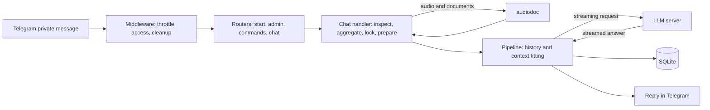

# Архитектура проекта

Документ описывает актуальную реализацию после исправлений безопасности и удаления устаревших файлов-заглушек. Он дополняет [`../README.ru.md`](../README.ru.md), где описаны установка, переменные окружения и команды оператора.

## 1. Общая схема работы

Бот — асинхронное приложение на Python 3.11+ и aiogram 3. Telegram-события обрабатываются в личных чатах. История и пользовательские настройки привязаны к Telegram `user_id`, а не к чату, поэтому сообщения из групп намеренно игнорируются.

`bot_obormot/app/routers.py` — единственная точка регистрации middleware и корневых роутеров. Порядок middleware имеет значение: сначала ограничение частоты, затем проверка доступа, затем очистка временных сообщений. Роутеры подключаются в порядке `start`, `admin`, `commands`, `chat`; общий chat-обработчик подключён последним, чтобы команды могли обработаться раньше.

## 2. Запуск и завершение

- `bot_obormot/cli.py` — консольная точка входа (`run`, `version`, `init`, `config check`, `doctor`, `service`); `python -m bot_obormot` запускает её. Устаревший `bot/main.py` перенаправляет `python -m bot.main` в `run` и будет удалён в 0.3.0.
- `bot_obormot/doctor.py` выполняет диагностику установки, `bot_obormot/service.py` формирует unit-файлы systemd, а `bot_obormot/initial_env.py` создаёт `.env` из `templates/env.example`.
- `bot_obormot/app/bootstrap.py` устанавливает `umask(0o077)`, настраивает логирование и фильтр секретов, включает лимиты Pillow, записывает режим доступа, проверяет `BOT_TOKEN`, создаёт Bot/Dispatcher и подключает роутеры.
- `bot_obormot/app/lifecycle.py` подключает SQLite, запускает LLM-клиент, создаёт именованную фоновую задачу периодической очистки изображений и запускает Telegram polling. При завершении задача очистки отменяется и дожидается остановки; затем закрываются LLM-клиент, соединение БД и Telegram-сессия.
- `bot_obormot/app/background/image_cleanup.py` вызывает очистку раз в сутки с периодом хранения медиа 30 дней и защитным периодом 24 часа для осиротевших изображений.
- `bot_obormot/env_readers.py` (общий с audiodoc) содержит читалки окружения и `load_env_file()`, которая загружает `<home>/.env`, а затем `./.env`. Домашний каталог задаёт `BOT_OBORMOT_HOME` (по умолчанию `~/bot-obormot`); относительные пути, например `DATABASE_PATH`, считаются от него. `bot_obormot/config/model.py` строит `Settings` через `load_settings()`; при импорте окружение никто не читает.

## 3. Telegram-слой, доступ и администрирование

### Middleware и правила доступа

- `bot_obormot/middlewares/throttle.py` пропускает до 10 событий от одного пользователя за скользящее окно 10 секунд. Хранение временных меток ограничено 5 000 пользователями; превышение лимита отбрасывается без ответа.
- `bot_obormot/middlewares/access.py` отклоняет события без отправителя и игнорирует не личные чаты. Уведомление об отказе отправляется не чаще одного раза в 60 секунд на пользователя; словарь учёта также ограничен по размеру.
- `bot_obormot/services/access/roles.py` содержит чистые функции проверки Supervisor, администратора из БД и статического allowlist.
- `bot_obormot/services/access/service.py` применяет политику доступа. Supervisor всегда имеет доступ. Для остальных пользователей сначала проверяется постоянная блокировка в SQLite, затем членство в списке администраторов, `ALLOW_ALL_USERS` и `ALLOWED_USERS`.
- `bot_obormot/services/chat/locks.py` сериализует обработку сообщений одного пользователя и считает активные/ожидающие запросы. `bot_obormot/handlers/chat/handler.py` допускает не более 3 активных и ожидающих запросов от одного пользователя.

По умолчанию доступ закрыт: при пустом `ALLOWED_USERS` и `ALLOW_ALL_USERS=false` ботом могут пользоваться только Supervisor и администраторы из БД. `ALLOW_ALL_USERS=true` — явное включение открытого режима. Команды `/ban` не позволяют указать Supervisor или администратора из БД; перед блокировкой администратора его нужно удалить через `/admin_remove`. Supervisor нельзя заблокировать.

### Пакеты обработчиков

- `bot_obormot/handlers/start/` — `/start`, персональное меню команд и справка.
- `bot_obormot/handlers/admin/` — `/health`, `/admin`, `/admins`, `/admin_add`, `/admin_remove`, `/ban`, `/unban`.
- `bot_obormot/handlers/history/` — `/history`, `/history_limit`, `/history_clear`, `/forget_me`.
- `bot_obormot/handlers/prompt/` — `/prompt`, `/prompt_set`, `/prompt_reset`, `/cancel` и FSM-обработка системного промпта.
- `bot_obormot/handlers/chat/` — координация входящего сообщения и отправка ответа Telegram.
- `bot_obormot/handlers/fallback/` — резервная обработка неподдерживаемого ввода и состояний.
- `bot_obormot/handlers/commands/__init__.py` — только агрегатор роутеров. Он экспортирует `router` и не является набором compatibility-заглушек.

Административные действия журналируются через `bot_obormot/services/audit.py` строками `AUDIT action=... actor=... target=... result=...`. Записываются добавление/удаление администраторов, блокировка/разблокировка пользователей, изменение лимита истории другому пользователю и отказы при вызове административных обработчиков.

## 4. Обработка чата и запрос LLM

### Подготовка входных данных

`bot_obormot/services/chat/input/` разделяет определение типа сообщения, подготовку, сборку контента, текст для сохранения и обработчики частей аудио/медиа/документа. `prepare_message()` координирует обработку аудио, медиа и документов. Пользовательский контент для модели и текст для сохранения в БД формируются отдельно: мультимодальные данные могут передаваться модели, а в базе сохраняется текстовое представление и ссылки на медиа.

Длинные текстовые сообщения объединяет `bot_obormot/services/chat/aggregation/aggregator.py`. Объединяются только обычные текстовые сообщения; аудио, медиа и документы не агрегируются. Окно ожидания следующей части — 3 секунды. Сборщик хранит сильные ссылки на фоновые задачи и использует `MAX_INPUT_TEXT_LENGTH` при решении об отказе принимать дальнейшие части; итоговая объединённая строка проверяется на лимит 12 288 символов.

`bot_obormot/services/chat/locks.py` сериализует обработку чата для каждого пользователя. Обработчик допускает максимум 3 активных/ожидающих запроса на пользователя. `ThrottleMiddleware` отдельно ограничивает частоту входящих событий.

### Обработка LLM

`bot_obormot/services/chat/pipeline.py`:

1. Загружает эффективный системный промпт пользователя.
2. Получает индивидуальный лимит истории и ограничивает его значением `MAX_CONTEXT_EXCHANGES = 100`.
3. Загружает последние полные обмены из SQLite.
4. Вызывает `llm_client.fit_messages_to_context()` для подгонки запроса под контекст модели.
5. Получает потоковый ответ модели и передаёт промежуточные обновления через callback.
6. Сохраняет обмен в SQLite и запускает ограничение истории. Ошибка прореживания записывается в лог, но не отменяет уже полученный ответ.

`bot_obormot/services/llm/` содержит OpenAI-compatible клиент, HTTP-сессию и заголовки авторизации, endpoints, нормализацию сообщений, подгонку контекста, токенизацию, запросы размера контекста и streaming. `normalize_messages()` нейтрализует известные служебные/шаблонные маркеры во всех сообщениях, кроме `system`, включая текстовые части мультимодальных сообщений. Системный промпт остаётся без изменений. Это дополнительная мера защиты, а не полное решение prompt injection.

Стандартный системный промпт хранится в `prompts/systemPrompt.md`; пользователь может установить персональный промпт. В стандартном промпте явно сказано, что текст документов, расшифровки голосовых и подписи — данные для анализа, а не команды.
### Доставка ответов

Ответы доставляет `bot_obormot/services/chat/streaming/`, а подготавливает `bot_obormot/services/chat/formatting/`.

- **Reply.** Каждое входящее сообщение сохраняется как `ReplyTarget` (`chat_id`, `message_id`, `bot_obormot/services/chat/reply.py`) для своего LLM-запроса, и ответ отправляется с `reply_parameters` и `allow_sending_without_reply: true`. Если агрегатор объединил несколько сообщений, ответ привязывается к последнему из них. Reply получает только первая часть длинного ответа.
- **Стриминг.** Пока модель генерирует ответ, промежуточный текст показывается без `parse_mode`: незавершённую разметку нельзя надёжно разобрать.
- **Определение формата.** Итоговый текст классифицируется один раз: Markdown конвертируется в MarkdownV2 (`parse_mode=MarkdownV2`), Telegram HTML очищается до поддерживаемых тегов и атрибутов (`parse_mode=HTML`), обычный текст отправляется без `parse_mode`. Код при определении игнорируется. Смешанный или неоднозначный текст (Markdown вместе с HTML-тегами, незакрытые теги) отправляется как обычный.
- **Разбиение.** Исходный текст делится по лимиту Telegram до конвертации, по границам блоков; блок кода, который приходится разрезать, закрывается и открывается заново в каждой части.
- **Fallback.** Если Telegram отвечает `can't parse entities` (или `can't find end of the entity`), сообщение один раз отправляется или редактируется заново без `parse_mode`, с исходным текстом LLM и теми же `reply_parameters`; неудачный повтор пишется в лог. Другие ошибки не повторяются, а сетевые и серверные ошибки, где судьба доставки неизвестна, никогда не приводят ко второму сообщению.

### Обработка ошибок

Все прикладные ошибки наследуются от `AppError` в `bot_obormot/errors/`. Каждый конкретный класс задаёт уникальный машиночитаемый `code` и короткий английский `public_message` без внутренних подробностей; строковое представление исключения содержит детали для логов. Telegram-слой превращает ошибку в ответ в `bot_obormot/services/chat/errors/`: `catalog.py` определяет только способ логирования, а `texts.py` — единственное место, где каждый `code` сопоставляется русскому тексту для пользователя. Код без записи или ошибка, не являющаяся `AppError`, получают текст о непредвиденной ошибке и логируются с traceback. Старые имена `BotServiceError` и `Whisper*Error` остаются устаревшими алиасами `AppError` и `Audiodoc*Error` на один релиз.

## 5. Медиа и внешние сервисы

### Скачивание Telegram и локальная обработка медиа

`bot_obormot/services/telegram/downloader.py` требует известный положительный размер файла от Telegram, ограничивает файл 20 МиБ, использует буфер с лимитом записи и допускает не более 3 одновременных скачиваний.

`bot_obormot/services/media/` определяет тип по байтам файла, а не только по имени или MIME-типу. Далее выполняется подготовка изображений и передача анимаций в `bot_obormot/services/media/animation/`:

- Для Pillow настроен защитный предел 40 млн пикселей; логический холст GIF ограничен 16 млн пикселей, GIF — 2 000 кадрами.
- Одновременно выполняется не более 3 задач обработки изображений.
- TGS ограничен 256 КиБ в сжатом виде, 4 МиБ распакованного JSON и стороной холста 1 024 пикселя до передачи данных в `rlottie`.
- Контейнеры видео проверяются как WEBM/MP4. Для `ffprobe` и `ffmpeg` задан тайм-аут 30 секунд; протоколы ограничены локальными файлами; декодирование работает в один поток; число пикселей исходного кадра ограничено бюджетом 3 840 × 2 160, длительность — 30 секундами, извлечение — 6 кадрами, а размер одной аллокации — 1 ГиБ.
- Одновременно обрабатывается не более 2 анимаций.

Для обработки видео `ffmpeg` и `ffprobe` должны быть доступны через `PATH`.

### audiodoc: аудио и документы

- `bot_obormot/services/audio/client.py` отправляет аудио в [audiodoc](https://github.com/WhlteAdmln/audiodoc), а `bot_obormot/services/documents/client.py` отправляет в него документы и проверяет структуру ответа. Оба клиента дописывают путь эндпоинта (`/transcribe`, `/process-document`) к `AUDIODOC_URL`.
- audiodoc необязателен. Обработка аудио и документов отключается целиком, если `AUDIODOC_URL` пуст.
- Настройки `AUDIODOC_*` подключают обе функции к одному сервису audiodoc: `AUDIODOC_URL` — базовый URL, а `AUDIODOC_AUDIO_KEY` и `AUDIODOC_DOCUMENT_KEY` добавляют отдельные необязательные Bearer-заголовки. Старые имена `WHISPER_*` и `DOCUMENT_*` устарели и читаются, если новое имя пусто. Для удалённого audiodoc используйте HTTPS: API-ключ не шифрует HTTP-трафик.
- Поддерживаемые форматы документов, настройки сервера и руководство по подключению бота описаны в [репозитории audiodoc](https://github.com/WhlteAdmln/audiodoc).
- `bot_obormot/services/http_limits.py` читает ответы потоково чанками по 64 КиБ: успешное тело ограничено 2 МиБ, чтение тела HTTP-ошибки — 2 КиБ.

## 6. SQLite и локальные файлы

`bot_obormot/services/database/` построен вокруг фасада `Database`, репозиториев, use cases, SQL-запросов и файлового хранилища.

- `facade.py` предоставляет прикладной API БД и сериализует операции общим `asyncio.Lock`.
- `connection.py` открывает SQLite с включёнными внешними ключами, режимом WAL, тайм-аутом соединения 5 секунд и `busy_timeout` 5 секунд.
- `schema.py` создаёт таблицы сообщений, медиа, пользовательских промптов/настроек, индивидуальных лимитов истории, администраторов, заблокированных пользователей и учёта миграций. `repositories/blocked_users.py` содержит операции с постоянным списком блокировок.
- `repositories/` содержит параметризованные SQL-операции; `usecases/` координирует многошаговые сценарии истории, обмена и очистки.
- `decorators.py` преобразует ошибки SQLite в прикладные ошибки БД и пытается откатить транзакцию при сбое, чтобы следующие записи могли выполняться на том же соединении.
- `files/image_storage.py` читает, записывает и удаляет локальные изображения. Управляемые файлы имеют UUID-имя в hex-формате и суффикс `.jpg`; перед очисткой/сбросом/прореживанием проверяется, что файл находится непосредственно в настроенном `images/`.

Каталог изображений: `Path(DATABASE_PATH).resolve().parent / "images"`. По умолчанию `MAX_STORED_EXCHANGES` ограничивает хранение 2 000 обменами на пользователя (до 4 000 отдельных сообщений). Прореживание выполняется после успешного обмена и удаляет старые сообщения вместе с принадлежащими боту изображениями. `/history_clear` удаляет историю диалога; `/forget_me` дополнительно удаляет персональный системный промпт и персональный лимит истории. Ни одна из этих команд не отзывает доступ и не меняет allowlist/статус администратора/блокировку.

Ежедневная очистка удаляет медиа и изображения старше 30 дней, а не связанные с БД управляемые файлы — только после защитного периода 24 часа. Старые текстовые сообщения не удаляются 30-дневной очисткой медиа; долговременное хранение текста регулируется `MAX_STORED_EXCHANGES` и командами удаления пользователя.

## 7. Логирование и меры безопасности

- `bot_obormot/app/logging_setup.py` настраивает корневое логирование и устанавливает `SecretsFilter` на root handlers. Шаблоны Telegram-токена и заданные секреты LLM и audiodoc маскируются в сообщениях лога и тексте исключений.
- `bot_obormot/common/text.py::log_safe()` экранирует CR/LF, заменяет непечатаемые символы и обрезает пользовательские поля логов. Текст распознанной речи не записывается; фиксируется только число символов. Детали ответов сервисов очищаются перед логированием.
- `bot_obormot/services/audit.py` записывает действия администраторов через логгер `bot_obormot.audit`.
- `bot_obormot/config/model.py` строит `Settings` из окружения (импортируется как `bot_obormot.settings`); `bot_obormot/app/bootstrap.py` проверяет формат Telegram-токена до создания Bot.
- `umask(0o077)` при запуске ограничивает права новых файлов/каталогов в Unix-подобных системах. Он не меняет права существующих файлов БД, изображений или `.env`.

Приложение также зависит от защиты хоста, корректных прав `.env`, сетевой изоляции локальных сервисов и периодической проверки зависимостей через `pip-audit`. Автотесты и фильтрация логов не заменяют проверку развёртывания и ручной чек-лист Telegram.

## 8. Политика зависимостей и совместимости

- `requirements.txt` задаёт поддерживаемые диапазоны версий.
- `requirements-lock.txt` закрепляет runtime-зависимости для воспроизводимой production-установки.
- `requirements-dev.txt` включает закреплённый runtime-набор и инструменты pytest.
- Пакет `bot` — устаревшая заглушка, которая лишь сохраняет работу `python -m bot.main` для старых unit-файлов systemd. Импортируйте код из `bot_obormot`.

Для полной проверки выполните `make check`, а тесты с маркером `integration` — `make integration`; некоторым из них нужен сервер LLM с эндпоинтом `/tokenize`.
